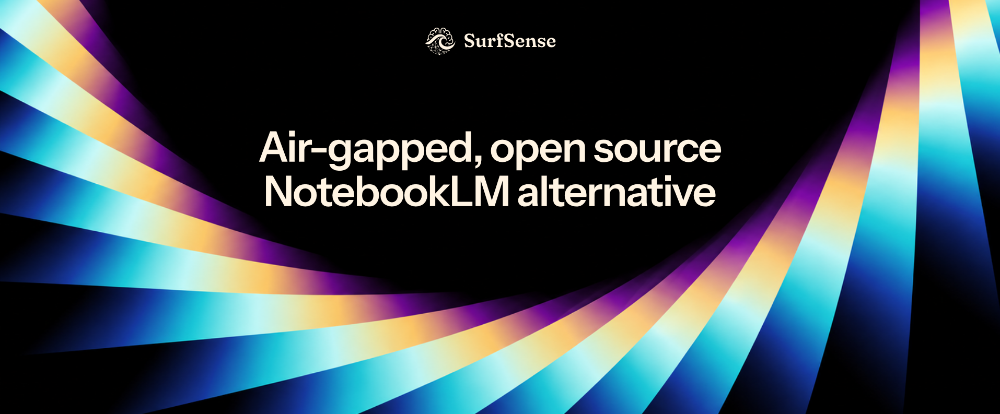

<!--
  El aviso del cierre del servicio alojado tiene fecha de caducidad: elimínalo
  el 18 de octubre de 2026, junto con el mismo aviso en README.md.
  Este archivo sigue a README.md sección por sección.
  Justificación: plans/community-local/seo/06-repo-readme.md
-->

  

  <h1>SurfSense</h1>

  

    <b>La alternativa de código abierto a NotebookLM, aislada de la red.</b>
     
    El agente de IA que investiga, transforma y edita tus documentos, en tu propio equipo.
  

  

    <a href="https://www.surfsense.com/downloads"><b>Descargar</b></a> ·
    <a href="#qué-hace-con-cada-formato">Formatos</a> ·
    <a href="#inicio-rápido">Inicio rápido</a> ·
    <a href="#cómo-se-compara">Comparativa</a> ·
    <a href="#plugins">Plugins</a> ·
    <a href="https://www.surfsense.com/pricing">Precios</a> ·
    <a href="https://discord.gg/ejRNvftDp9">Discord</a>
  

  

  

    <a href="README.md">English</a> | <a href="README.ar.md">العربية</a> | <a href="README.de.md">Deutsch</a> | Español | <a href="README.fr.md">Français</a> | <a href="README.hi.md">हिन्दी</a> | <a href="README.ja.md">日本語</a> | <a href="README.ko.md">한국어</a> | <a href="README.pt-BR.md">Português</a> | <a href="README.ru.md">Русский</a> | <a href="README.zh-CN.md">简体中文</a>
  

**Revisa un contrato con control de cambios y comentarios**

https://github.com/user-attachments/assets/88326b9d-e763-46db-9635-75f9df9e8682

**Añade fuentes desde la web y conviértelas en una página web**

https://github.com/user-attachments/assets/073577b7-f055-4f59-8540-330bd764aeb0

SurfSense es una aplicación de escritorio gratuita y de código abierto para los documentos que no puedes subir a la nube. Es un agente de IA al estilo de NotebookLM, centrado en la privacidad, que investiga, transforma y edita tus documentos en tu propio equipo. El índice se queda en tu disco, tú eliges el modelo, local o remoto, y no hay ninguna cuenta que crear.

| Plataforma | Descarga |
|---|---|
| **Windows** x64 | [SurfSense-Setup.exe](https://www.surfsense.com/downloads/windows?src=readme) |
| **macOS** Apple Silicon | [SurfSense-arm64.dmg](https://www.surfsense.com/downloads/mac?src=readme) |
| **Linux** x64 | [AppImage](https://www.surfsense.com/downloads/linux-appimage?src=readme) · [deb](https://www.surfsense.com/downloads/linux-deb?src=readme) |

## Inicio rápido

1. Instala SurfSense y completa la configuración inicial.
2. Suelta tus archivos o carpetas en tus fuentes.
3. Pide al agente que busque en tus archivos, extraiga contenido de ellos o los edite.

## Qué hace con cada formato

| Formato | Investigar (respuestas con citas) | Crear | Editar (en una copia) | Transformar |
|---|---|---|---|---|
| **PDF** | ✓ incluso páginas escaneadas³ | ✓ | Rellenar y aplanar formularios; estampar marcas de agua, números de página, encabezados y pies de página | Combinar, dividir, extraer, rotar y reordenar páginas |
| **Word** `.docx` | ✓ | ✓ o a partir de tu propio `.docx` como plantilla | ✓ cuerpo del texto, con control de cambios y comentarios | A PDF¹ |
| **Excel** `.xlsx` | ✓ el agente también lee las fórmulas | ✓ con fórmulas y gráficos nativos | ✓ valores de celda y fórmulas | Analizar con pandas y representar los resultados en gráficos |
| **PowerPoint** `.pptx` | ✓ | ✓ o a partir de tu propio `.pptx` como plantilla | Reemplazar texto en diapositivas y notas; eliminar o duplicar diapositivas | A PDF¹ |
| **CSV** | ✓ | — | — | Analizar con pandas y representar los resultados en gráficos |
| **Imágenes** PNG, JPEG, TIFF, BMP, WebP | ✓ texto leído por OCR³ | Imágenes e infografías² | — | Insertar en documentos nuevos |
| **Markdown**, texto sin formato | ✓ | ✓ Markdown | — | — |
| **HTML** | ✓ | ✓ página web | — | — |
| **Grabaciones** WAV, MP3, FLAC, Ogg Vorbis | ✓ transcritas en tu equipo | — | — | — |
| **Podcast** (audio) | — | ✓ con transcripción; por defecto, la voz se genera en tu equipo | — | — |
| **Mapas mentales, tarjetas didácticas, cuestionarios** | — | ✓ en la aplicación | — | — |

¹ Con la compatibilidad con Office (LibreOffice) activada en Ajustes; nunca viene incluida en el instalador. ² Necesita un modelo de imagen, local o remoto; no hay ninguno elegido por defecto. ³ El OCR lee escritura latina, china y japonesa.

Las ediciones, las conversiones y las herramientas de PDF siempre crean un archivo nuevo; tu original nunca se modifica. Hoy por hoy, PDF, Word y Excel son los formatos con los que más se puede hacer, y la compatibilidad con el resto de formatos no deja de mejorar.

## Plugins

Conéctalos en **Ajustes › Plugins**.

**De SurfSense.** Leen páginas públicas sin usar tus propias cuentas y necesitan una licencia de SurfSense: [descarga la aplicación](https://www.surfsense.com/downloads) e introduce allí tu correo electrónico para conseguir una gratuita de 14 días.

| Plugin | Qué hace |
|---|---|
| **Google Search** | Buscar en Google y leer sus resultados, anuncios y preguntas relacionadas |
| **Web Crawl** | Leer una página web o rastrear un sitio entero y convertirlo en texto limpio |
| **YouTube** | Leer videos y canales de YouTube, con sus comentarios |
| **TikTok** | Leer videos de TikTok y sus comentarios, buscar usuarios y ver qué es tendencia |
| **Reddit** | Leer publicaciones públicas de Reddit con sus hilos de comentarios, o una comunidad entera |
| **Instagram** | Leer perfiles, publicaciones y reels públicos de Instagram, y buscar perfiles |
| **Google Maps** | Encontrar lugares en Google Maps y leer sus reseñas |
| **Amazon** | Leer productos y resultados de búsqueda de Amazon |
| **Walmart** | Leer productos, resultados de búsqueda y reseñas de Walmart |
| **Indeed** | Leer ofertas de empleo en Indeed |

**De terceros.** Servidores MCP del [registro de plugins](backend/plugins/registry), como DeepWiki y Notion, o cualquiera que añadas por URL. No necesitan licencia; siguen desactivados hasta que los permitas.

## Cómo se compara

| | NotebookLM (ahora Gemini Notebook) | SurfSense |
|---|---|---|
| Funciona sin conexión / aislado de la red | No | **Sí** |
| Tus documentos salen de tu equipo | Sí | **No**, salvo que elijas un modelo remoto |
| Puede editar tus archivos | No | **Sí** |
| Código abierto | No | **Apache-2.0** |
| Modelos | Solo Gemini | Cualquier API compatible con OpenAI, o una local |

## Comunidad

- [Discord](https://discord.gg/ejRNvftDp9) para pedir ayuda, [Issues](https://github.com/MODSetter/SurfSense/issues) para errores y [Discussions](https://github.com/MODSetter/SurfSense/discussions) para ideas.
- **Contribuir:** los PR se abren contra `dev`; consulta [CONTRIBUTING.md](CONTRIBUTING.md) y [`surfsense_local/`](./surfsense_local) para el ciclo de desarrollo. En [`docs/`](docs/README.md) se explica cómo funciona.

## Licencia

Apache-2.0. Consulta el archivo [LICENSE](LICENSE).
